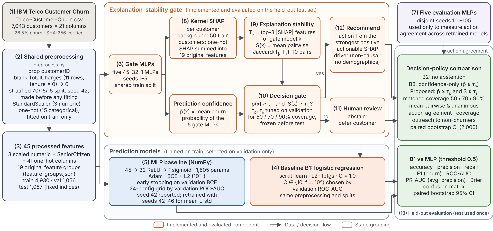

# When Should a Churn Model Recommend or Abstain? Stability-Aware Explainable Deep Learning for Customer Retention

CAI 421 Deep Learning group research project, Princess Nourah bint Abdulrahman University
(target venue: ICBITS 2027, Track 6: Artificial Intelligence for Business).

Team: Joud Alharbi · Raya Almoqaiteeb · Jana Jali · Modi Alquheedan · Shmokh Abdullah Alotaibi

The project predicts customer churn on the IBM Telco Customer Churn dataset with a NumPy multilayer
perceptron (MLP), compares it with a logistic-regression baseline, and evaluates whether customer-level SHAP
explanation stability across independently trained MLPs improves the consistency of retention suggestions
compared with confidence-only abstention at matched coverage. **The stability gate is implemented and was
evaluated on the held-out test set; it did not improve action agreement (negative result).**



*Figure 1 of the paper: all components shown are implemented and evaluated.*

## Main results (held-out test set, n = 1,057)

Predictive performance (threshold 0.5):

| Model | ROC-AUC | PR-AUC | F1 (churn) | Brier |
|---|---|---|---|---|
| B1 logistic regression | 0.845 | 0.658 | 0.597 | 0.136 |
| MLP, seed 42 (baseline) | 0.843 | 0.654 | 0.545 | 0.137 |
| Gate ensemble (mean of 5 MLPs) | 0.846 | 0.656 | 0.549 | 0.136 |

Action agreement of five independent evaluation models (seeds 101–105), thresholds selected on validation only:

| Target coverage | B3 confidence-only | Proposed confidence + stability | Difference (paired bootstrap 95% CI) |
|---|---|---|---|
| 50% | 0.919 | 0.918 | −0.001 [−0.015, +0.013] |
| 70% | 0.902 | 0.868 | −0.034 [−0.048, −0.021] |
| 90% | 0.855 | 0.845 | −0.011 [−0.015, −0.006] |

Mean customer-level SHAP stability S(x) is 0.693 on test. Stability is weakly related to action agreement
(Spearman ρ = −0.09), whereas mean churn probability is positively related (ρ = 0.39). The dataset has no
retention-intervention outcomes, so the project measures reproducibility of suggestions, not causal benefit.
Full tables: `tables/`; figures: `figures/`; all numbers: `results/results_summary.json`.

## Repository layout

```
preprocess.py                 shared pipeline: stratified 70/15/15 split (seed 42), train-only scaling/one-hot
mlp.py, train_mlp.py          NumPy MLP (45-32-1) and baseline training/tuning
gradient_check.py             Checkpoint 2 finite-difference gradient check
tests/gradcheck.py            final backpropagation check (supports the induction proof)
train_logistic_regression.py  B1 logistic-regression baseline
compare_models.py             B1 vs MLP with paired bootstrap
kernel_shap_numpy.py          Kernel SHAP in NumPy (self-test against brute-force Shapley values)
run_shap_stability.py         five gate MLPs (seeds 1-5), SHAP, stability S(x)
make_shap_report.py           SHAP-stability figures and report text
run_eval_seed.py              evaluation MLPs (seeds 101-105), SHAP on test
build_gate_inputs.py          joins gate and evaluation outputs
abstention_gate.py            B2 / B3 / proposed policies: select (validation) and evaluate (test, once)
evaluate_results.py           final tables, bootstrap intervals, figures, published-study comparison
make_results_section.py       report-ready Results section
run_all.sh                    runs the final-stage pipeline in order
reproduce.sh                  rebuilds the baseline (B1 vs MLP) results
configs/experiment_config.json  seeds, split, grid, expected file hashes
results/, tables/, figures/   saved outputs used in the paper
docs/                         component notes (data, SHAP stability, abstention gate, results, reproduction check)
```

## Contributions

| Component | Files | Owner |
|---|---|---|
| Shared preprocessing and fixed split | `preprocess.py`, `DATA_README.md` | Student 3 |
| NumPy MLP baseline and gradient check | `mlp.py`, `train_mlp.py`, `gradient_check.py`, `MLP_README.md` | Student 5 |
| Logistic-regression baseline, comparison, configuration | `train_logistic_regression.py`, `compare_models.py`, `configs/`, `reproduce.sh` | Student 4 |
| Kernel SHAP and explanation stability | `kernel_shap_numpy.py`, `run_shap_stability.py`, `make_shap_report.py` | Student 2 |
| Evaluation models and abstention gate | `run_eval_seed.py`, `build_gate_inputs.py`, `abstention_gate.py` | Student 3 |
| Final evaluation, tables and figures | `evaluate_results.py`, `make_results_section.py` | Student 4 |
| Reproducibility, final gradient check, course appendix | `tests/gradcheck.py`, `run_all.sh`, `docs/REPRODUCTION_CHECK.md` | Student 5 |

## Obtaining the dataset

The CSV is **not** included (its redistribution licence is unverified; see Section 3 of the paper).

```bash
git clone --depth 1 https://github.com/IBM/telco-customer-churn-on-icp4d.git /tmp/ibm-telco
mkdir -p data/raw
cp /tmp/ibm-telco/data/Telco-Customer-Churn.csv data/raw/
# expected SHA-256: 16320c9c1ec72448db59aa0a26a0b95401046bef5d02fd3aeb906448e3055e91
```

## Reproducing the results

Python 3.12+ (reported run: Python 3.13), CPU only.

```bash
python -m venv .venv && source .venv/bin/activate      # Windows: .venv\Scripts\activate
pip install -r requirements.txt

bash reproduce.sh     # baseline: preprocessing, B1, B1 vs MLP (about 1 minute)
bash run_all.sh       # final stage: gradient check, SHAP stability, evaluation models,
                      # abstention gate, tables and figures (about 30-40 minutes on 2 CPU cores)
```

A final-stage re-run on 19 November 2026 (from the shared processed splits) reproduced every saved result,
table and figure; see `docs/REPRODUCTION_CHECK.md`.

## Fixed experimental settings

| Setting | Value |
|---|---|
| Split | stratified 70/15/15, seed 42 (train 4,930 / val 1,056 / test 1,057) |
| Features | 45 encoded (3 standardized numeric, SeniorCitizen, 41 one-hot) → 19 original features |
| MLP | 45→32 ReLU→1 sigmoid, Adam lr 0.003, batch 128, L2 1e-4, ≤300 epochs, patience 20 |
| B1 | L2 logistic regression, lbfgs, C chosen from {0.001 … 100} by validation ROC-AUC (C = 1.0) |
| Kernel SHAP | shared 50-row training background (seed 2026); signed one-hot SHAP summed to 19 features |
| Stability S(x) | mean pairwise Jaccard of top-3 \|SHAP\| feature sets over the 10 gate-model pairs |
| Seeds | split 42 · gate MLPs 1–5 · evaluation MLPs 101–105 · baseline MLP 42–46 · bootstrap 42 (2,000 resamples) |
| Test set | used once, after all model and threshold selection on validation |

## Data handling

- `data/` and per-customer files written by the scripts are git-ignored; never commit customer-level data.
- `results/mlp_test_predictions_seed42.csv` holds test labels and predicted probabilities only (no customer
  identifiers or features); `compare_models.py` reads it.
- `results/logreg/logreg_model.joblib` is a pickle: load it only from this repository.

## AI-assistance disclosure

AI tools were used for language editing and coding support, including code review and testing. The team
reviewed and is responsible for all code, text and reported results; all reported numbers were produced by
the code in this repository.
