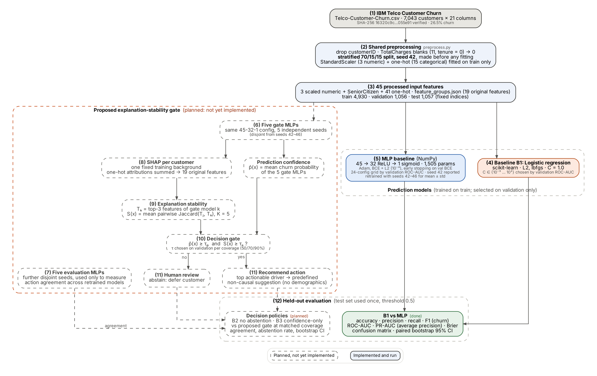
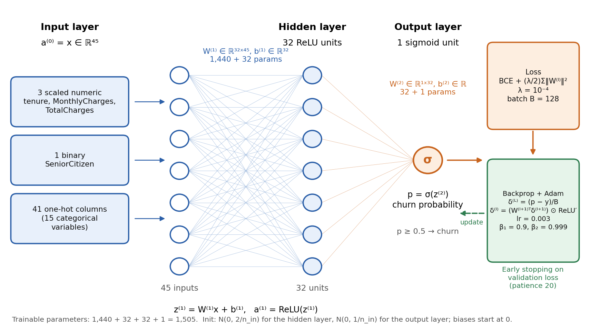

# CAI 421 Deep Learning: Telco customer churn with an explanation-stability gate

Group research project for CAI 421 (Princess Nourah bint Abdulrahman University). The project predicts
customer churn on the IBM Telco Customer Churn dataset with a multilayer perceptron (MLP), compares it with a
logistic-regression baseline under one shared protocol, and (planned) uses SHAP explanation stability across
independently seeded MLPs to decide whether to recommend a retention action or defer a customer to human review.



*Solid boxes are implemented and have been run; dashed boxes are planned and have no code yet.*



*The 45–32–1 MLP with its loss, optimizer and early-stopping components (source: `docs/architecture/render_mlp_architecture.py`).*

## Status (Checkpoint 2)

| Component | Owner | Status |
|---|---|---|
| Shared preprocessing and fixed 70/15/15 split (`preprocess.py`) | Student 3 | Implemented, verified |
| MLP baseline 45→32→1 in NumPy (`mlp.py`, `train_mlp.py`, `gradient_check.py`) | Student 5 | Implemented, results saved |
| Logistic-regression baseline B1 (`train_logistic_regression.py`) | Student 4 | Implemented, run |
| B1 vs MLP comparison (`compare_models.py`) | Student 4 | Implemented, run |
| Repository, requirements, reproducibility settings, architecture diagram | Student 4 | Done |
| Five gate MLPs, SHAP, explanation stability S(x), decision gate, five evaluation MLPs, B2/B3 policies | Team | **Planned, not implemented** |

## Results so far (test set, n = 1,057, threshold 0.5)

| Metric | Logistic regression B1 | MLP (seed 42) |
|---|---|---|
| Accuracy | 0.811 | 0.798 |
| Precision (churn) | 0.688 | 0.677 |
| Recall (churn) | 0.527 | 0.456 |
| F1 (churn) | 0.597 | 0.545 |
| ROC-AUC | 0.845 | 0.843 |
| PR-AUC (average precision) | 0.658 | 0.654 |
| Brier score (lower is better) | 0.136 | 0.137 |
| Confusion matrix (TN / FP / FN / TP) | 709 / 67 / 133 / 148 | 715 / 61 / 153 / 128 |

Full values, the MLP five-seed mean ± std and paired-bootstrap 95% intervals for the differences are in
`results/comparison/lr_vs_mlp_test.csv`. These numbers come from one fixed test split: the ranking metrics
(ROC-AUC, PR-AUC) and the Brier score are statistically indistinguishable here, and the recall/F1 gap is
specific to the 0.5 threshold.

## Repository layout

```
preprocess.py                  Student 3  shared pipeline: load_splits()            (unchanged)
DATA_README.md                 Student 3  dataset/pipeline notes                    (unchanged)
mlp.py, train_mlp.py,          Student 5  NumPy MLP, tuning, evaluation             (unchanged)
gradient_check.py, MLP_README.md
results/mlp_*.json|csv|npz,    Student 5  saved MLP outputs                         (unchanged)
results/gradient_check.json, figures/mlp_*.png
train_logistic_regression.py   Student 4  B1 baseline
compare_models.py              Student 4  B1 vs MLP + paired bootstrap
configs/experiment_config.json Student 4  seeds, split, grid, expected file hashes
reproduce.sh                   Student 4  one-command rebuild of the Student 4 results
results/logreg/                Student 4  validation grid, metrics JSON, coefficients, fitted model
results/comparison/            Student 4  comparison table (CSV + JSON)
figures/logreg/                Student 4  confusion matrix, ROC + PR comparison
docs/architecture/             Student 4  final diagram (.dot source, .svg, 300-dpi .png, render.py)
```

## Obtaining the dataset

The CSV is **not** included (its redistribution licence is unverified; see Section 3 of the paper).

```bash
git clone --depth 1 https://github.com/IBM/telco-customer-churn-on-icp4d.git /tmp/ibm-telco
mkdir -p data/raw
cp /tmp/ibm-telco/data/Telco-Customer-Churn.csv data/raw/
python -c "import hashlib;print(hashlib.sha256(open('data/raw/Telco-Customer-Churn.csv','rb').read()).hexdigest())"
# expected: 16320c9c1ec72448db59aa0a26a0b95401046bef5d02fd3aeb906448e3055e91
```

The same file can also be downloaded by hand from
<https://github.com/IBM/telco-customer-churn-on-icp4d/blob/master/data/Telco-Customer-Churn.csv>
(use "Download raw file") and placed at `data/raw/Telco-Customer-Churn.csv`.

## Reproducing the results

Python 3.13, CPU only. Everything below runs in under a minute.

```bash
python -m venv .venv && source .venv/bin/activate      # Windows: .venv\Scripts\activate
pip install -r requirements.txt

python preprocess.py                 # 1. shared splits -> data/processed/ (deterministic, seed 42)
python train_logistic_regression.py  # 2. B1 -> results/logreg/, figures/logreg/lr_confusion_matrix.png
python compare_models.py             # 3. B1 vs MLP -> results/comparison/, figures/logreg/lr_vs_mlp_roc_pr.png
# or run steps 1-3 together:  bash reproduce.sh

# Optional: Student 5's MLP (overwrites results/mlp_* and figures/mlp_* with a fresh run)
python gradient_check.py
python train_mlp.py

# Optional: redraw the architecture diagram (needs Graphviz `dot`)
python docs/architecture/render.py
```

`train_logistic_regression.py` stops with an error if any processed file differs from the team's reference
SHA-256 values in `configs/experiment_config.json`, so B1 can only run on the exact splits the MLP used.

## Fixed experimental settings

| Setting | Value |
|---|---|
| Split | stratified 70/15/15, `random_state=42` (train 4,930 / val 1,056 / test 1,057) |
| Features | 45 (3 standardized numeric, SeniorCitizen, 41 one-hot); transformers fitted on train only |
| Decision threshold | 0.5 for accuracy, precision, recall, F1, confusion matrix |
| PR-AUC | `sklearn.metrics.average_precision_score` (average precision), same for both models |
| Metric code | `train_mlp.metrics`, imported by both Student 4 scripts |
| B1 | `LogisticRegression(solver="lbfgs", C=1.0, max_iter=10000, tol=1e-4, class_weight=None, random_state=42)`, L2 (default) |
| B1 selection | C ∈ {0.001, 0.01, 0.1, 1, 10, 100}, fitted on train, chosen by validation ROC-AUC (ties → smaller C) |
| MLP | 45→32 ReLU→1 sigmoid, Adam lr 0.003, batch 128, L2 1e-4, ≤300 epochs, patience 20; chosen from 24 configs by validation ROC-AUC |
| Seeds | 42 for split, B1, reported MLP; 42-46 for MLP mean ± std; bootstrap seed 42 (2,000 paired stratified resamples) |
| Test set | used once per model, after selection |

## Data handling

- `data/` and per-customer prediction files written by Student 4's scripts are git-ignored.
- `results/mlp_test_predictions_seed42.csv` (Student 5) holds per-customer test labels and probabilities.
  It is kept unchanged because `compare_models.py` reads it; the team should decide whether it may appear
  in a public repository.
- `results/logreg/logreg_model.joblib` is a pickle: load it only from this repository.

## AI-assistance disclosure

AI coding support was used to prepare Student 4's scripts, configuration and documentation, as required to be
disclosed in the course appendix. All reported numbers were produced by running the code in this repository.
